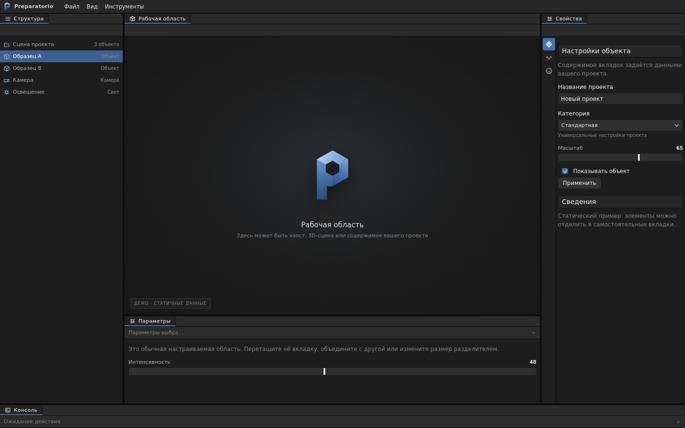

# UIX Preparatorio

Браузерная библиотека JavaScript для интерфейсов редакторов: доковые панели,
инструменты, настраиваемые контролы и тема.



## Установка

После публикации репозитория:

```bash
npm install git+https://github.com/Kilyakus/uix-preparatorio.git
```

Пакет использует ECMAScript-модули, DOM и зависимости Lumino. Для подключения
JavaScript и CSS нужен совместимый сборщик приложения. Сервер разработки и
сборка демонстрации — задача приложения-потребителя, не этой библиотеки.

## Использование

```js
import { createStudio } from 'uix-preparatorio';
import 'uix-preparatorio/styles.css';

const studio = await createStudio({
  id: 'my-editor', mount: '#app', title: 'Мой редактор', anchor: 'workspace',
  panels: [{ id: 'workspace', title: 'Рабочая область', render(container) {
    container.textContent = 'Содержимое приложения';
  } }],
});
```

Основной экспорт и отдельные пути `styles.css`, `base.css`, `lumino.css`,
`components.css`, `virtual-layout`, `compact-layout`, `logo.svg` и `mark.svg`
сохранены относительно исходного API. Тема содержит глобальные стили страницы.
Настройки раскладки сохраняются в браузерном localStorage; данные и элементы
управления приложения приложение сохраняет самостоятельно.

Подробности — в [документации API](docs/API.md).

## Структура

- `src/app/` — модули интерфейса и публичная точка `main.js`.
- `src/web/assets/css/` и `src/web/assets/images/` — экспортируемые стили и логотипы.
- `docs/` — описание API и иллюстрация.
- `tests/` — независимые модульные проверки (`npm test`).

Исходные модули и ресурсы перенесены из `nodejs-preparatorio` версии 2.0.1;
обратная совместимость не подразумевает сохранение старого имени npm-пакета —
в приложении нужно заменить пути импорта на `uix-preparatorio`.

Лицензия: [MIT](LICENSE), © 2026 Kilyakus.
